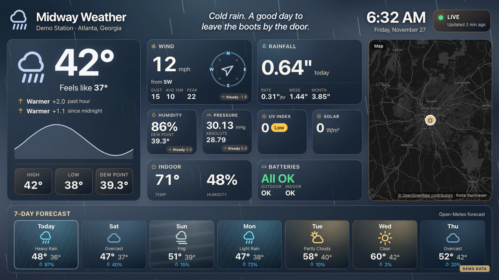
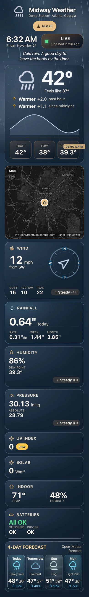
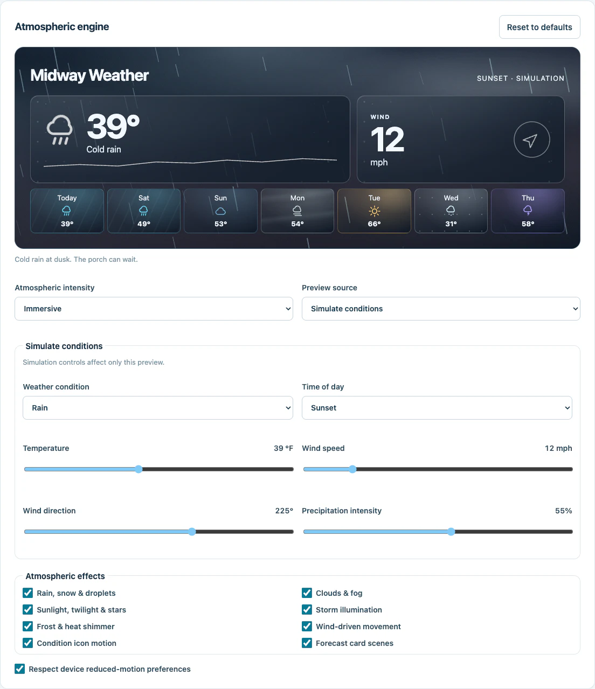

# Midway Weather

**Your weather station, made for the room you live in.**

Midway Weather is a customizable, self-hosted household weather display built around observations from an Ambient Weather station. It brings your station readings together with Open-Meteo forecasts, a radar map, recent trends, and weather-aware messages in one readable view.

It started as a Raspberry Pi kitchen display: something you can glance at across the room, without opening a weather app or reading a console full of tiny numbers. It grew into a self-hosted application with a responsive phone view and an administration interface for arranging tiles and adding your own personality. The server can run on another machine; a Raspberry Pi is an optional display device, not a hosting requirement.

**[Install on Windows](docs/installation/windows.md)** · **[Try the demo](#try-it-locally)** · **[Requirements and compatibility](docs/installation/requirements.md)** · **[Live dashboard](https://weather.midway-ecosystem.com/)**



*Atmosphere 2.0 on a local demo dashboard with synthetic station readings and forecast data.*

<details>
<summary><strong>The same dashboard on your phone</strong></summary>

The mobile layout stacks current conditions, the map, and station readings in a scrolling view and shows four forecast days on phones. Expand the full capture below, or open the [screenshot tour](docs/screenshots/README.md).



</details>

## What you can see

- **Your own station observations.** Outdoor temperature, feels-like temperature, daily high and low, dew point, humidity, wind direction and gusts, rainfall, pressure, UV, solar radiation, indoor conditions, and battery status where your station supplies them.
- **Configurable sensor readings.** Bind verified Ambient measurement channels to named tiles, with temperature unit conversion, observation freshness, and available recent history. See [sensor tiles and providers](docs/providers.md#explicit-sensor-tile-publication).
- **The direction things are heading.** Recent-history sparklines and changes in temperature, humidity, wind, and pressure, backed by local observation history.
- **The week ahead.** A seven-day Open-Meteo forecast with conditions, high/low temperatures, and precipitation probability.
- **Weather around you.** A Leaflet map with keyless OpenStreetMap base tiles (optional Stadia, MapTiler, or Mapbox) and an optional latest-frame RainViewer radar overlay. Choose the provider and preview its setup, location, zoom, and framing in admin.
- **A heading that feels like home.** Set your own dashboard title and subtitle, hide the subtitle, and choose a fixed weather icon or keep the weather/time-of-day icon. This personalizes the display without renaming Midway Weather.
- **A layout that fits your household.** Enable, disable, reorder, and resize supported tiles, with desktop and mobile draft previews before saving.
- **A little personality.** Edit the quip library, match messages to weather or time of day, and let the existing rotation keep them from repeating too often.
- **Atmosphere 2.0.** Wind-driven rain and snow, drifting clouds and fog, local twilight, frost, heat shimmer, and a different look for each forecast day. Adjust the effects in Admin or schedule a seasonal palette such as October / Fall.
- **A phone-friendly display.** Responsive layouts and optional home-screen installation through the PWA; no separate mobile app is required.
- **Useful visibility behind the scenes.** Source freshness, collection failures, scheduler heartbeat, release identity, and diagnostics in authenticated administration.

Available readings depend on the station's sensors and API payload. Collection runs every minute; the browser normally refreshes from the local application once a minute. This is polling, rather than a streaming connection to the station.

## Third-Party Environmental Sensor Integration

Midway Weather can bring environmental measurements into the same configurable dashboard as your weather station. The public application already supports explicitly configured tiles for verified Ambient Weather measurement channels, including temperature conversion and available measurement history.

A private Midway Weather deployment has also demonstrated live **pool water temperature from a Govee H5109 floating thermometer with an H5042 gateway**. That proof of concept combines scheduled cloud collection, timestamped historical samples, freshness indicators, and a configurable Pool Temperature tile.

**The Govee connector is not included in this public repository.** It is a privately validated integration, not an out-of-the-box provider option. Further indoor, pool, soil, and other environmental sensors are an expansion direction; Govee, Ecowitt, Home Assistant, MQTT, and additional Ambient sensors are possibilities, not a compatibility list or release commitment.

Read [environmental sensors: shipped features, private validation, and future options](docs/environmental-sensors.md) for the boundaries.

## Make it yours

### Arrange the display before you save

The layout editor previews the actual dashboard with current weather data. Change tile order, choose supported sizes, and hide readings you don't need. Drafts leave the live household display alone until you save.


### Personalize the heading

In **Admin → Display settings → Dashboard identity**, enter a title such as “Smith Family Weather” or “Jeff’s Weather,” set your own subtitle (or leave it blank), and choose a weather icon. Preview the draft on desktop or mobile before saving. Saved changes reach open dashboards on their next weather poll. Station metadata and radar location remain separate. See [dashboard identity](docs/admin.md#dashboard-identity) for defaults, limits, and upgrade behavior.

### Change the atmosphere

Atmosphere 2.0 makes the dashboard reflect what it feels like outside. Cold rain at sunset brings slanted rain and cool glass cards. Clear nights bring stars and moonlight, while snow adds drifting flakes and frost accents. Station readings, the daily forecast, and local sunrise and sunset shape the scene. The map and radar keep their own display layers.

Open **Admin → Themes** to choose **Off**, **Subtle**, **Balanced**, or **Immersive** (the default). Preview the latest weather or switch to **Simulate conditions** to try a different temperature, wind, precipitation intensity, or time of day. The simulation stays in that browser tab. Seasonal selection and recurring schedules are available in the same section. [Atmosphere and seasonal themes](docs/admin.md#atmosphere-and-seasonal-themes)



### Add your own voice


See the [complete screenshot tour](docs/screenshots/README.md) for mobile, theme schedules, map configuration, data sources, and system diagnostics. The gallery labels demo and simulated conditions separately from historical live captures.

## How it works

```text
Ambient Weather station → Ambient Weather API → observation collector ─┐
                                                                      ├→ SQLite → Blade dashboard + JSON APIs
Open-Meteo daily forecast ────────────────────→ forecast collector ─────┘

Browser → local weather API (periodic refresh)
Browser → OpenStreetMap (or configured Stadia / MapTiler / Mapbox) + RainViewer (map and radar)
Admin   → saved layout, quips, themes, and presentation settings
```

The server collects and stores the weather independently of any open browser. If a provider fails, the display keeps the last good data and reports freshness. Ambient credentials stay on the server.

The application uses **Laravel 13, PHP, SQLite, Blade, vanilla JavaScript, CSS, and locally bundled Leaflet**. There is no frontend build step, Redis requirement, or queue worker requirement with the example configuration. Node.js is used for contract validation during development and CI.

Read the [architecture guide](docs/architecture.md) for collection, persistence, public APIs, and extension points.

## Try it locally

**New to this, or using Windows?** Start with the [step-by-step Windows guide](docs/installation/windows.md). It explains installing the tools, trying demo data, connecting your Ambient station, starting the app each day, and [troubleshooting](docs/installation/windows.md#troubleshooting). You do not need to be a developer.

The **host computer** runs the application and stores weather history. The **display** is a browser on that computer or another reachable device. A Raspberry Pi is an optional display, not required hardware. Read [requirements and tested compatibility](docs/installation/requirements.md) before choosing a host; there is no measured minimum hardware specification.

The commands below are for **macOS/Linux with the prerequisites already installed**, not Windows PowerShell:

You need **PHP 8.3+**, **Composer 2**, the PHP extensions required by the locked dependencies, and **PDO SQLite / SQLite3**. The PHP runtime must also support Laravel's usual extensions, including mbstring, DOM/XML, cURL, and OpenSSL. Composer validates dependency requirements; ensure SQLite support is installed separately.

```bash
git clone https://github.com/thenumber3/midway-weather.git
cd midway-weather
cp .env.example .env
touch database/database.sqlite
composer install
composer check-platform-reqs
php artisan key:generate
php artisan migrate
php artisan weather:demo --hours=48
php artisan serve --host=127.0.0.1 --port=8000
```

Open [localhost:8000](http://localhost:8000/). The demo command writes synthetic station history and forecasts to your **local database**, so you can explore without an Ambient account. It does not connect a real station. Keep demo data separate from a live installation; never run the command against production.

The database directory, `storage/`, and `bootstrap/cache/` must be writable by the PHP process. Use `composer check-platform-reqs` to check your installed dependencies against your runtime.

### Connect your station

For a live installation, your station must already show current observations in your AmbientWeather.net account. Midway Weather reads that account API, not a USB connection or station-console IP. A WS5000 owner should first verify the existing account upload; this is not a claim of a model-specific hardware test. The [Windows station steps](docs/installation/windows.md#4-connect-your-ambient-weather-station) explain both keys, station selection, and a separate real-data database.

Start with a separate, empty SQLite database and configure `.env` using your own values:

```dotenv
AMBIENT_API_KEY=your-ambient-api-key
AMBIENT_APPLICATION_KEY=your-ambient-application-key
AMBIENT_DEVICE_MAC=AA:BB:CC:DD:EE:FF
WEATHER_STATION_NAME="My Weather"
WEATHER_LOCATION_NAME="My town"
WEATHER_LATITUDE=33.8595
WEATHER_LONGITUDE=-84.6769
WEATHER_TIMEZONE=America/New_York
WEATHER_DEMO_MODE=false
```

The coordinates above are a public town-center example. Choose your own approximate location; coordinates and location labels appear in public display data. Obtain both Ambient keys from your [Ambient Weather account](https://ambientweather.net/account). The MAC selects a station from your account; without it, the collector selects the first device. Open-Meteo needs no API key in the current integration.

```bash
php artisan optimize:clear
php artisan weather:collect
php artisan weather:forecast
php artisan weather:status
```

Keep collection running with `php artisan schedule:work` during local development. On a server, install **one** scheduler cron entry, using your actual application and PHP paths:

```cron
* * * * * cd /absolute/path/to/midway-weather && /usr/bin/php artisan schedule:run >> storage/logs/scheduler.log 2>&1
```

The scheduler collects observations every minute, forecasts hourly, and aggregates/prunes history daily at 03:00 station time. It also records a heartbeat and clears framework caches monthly. See [configuration and setup](docs/configuration.md) for admin credentials, provider access, map setup, and retention.

### Administration

Open `/admin` and sign in with your configured administrator email and password. There is no default password or public registration. Local setup uses `MIDWAY_WEATHER_ADMIN_EMAIL` and `MIDWAY_WEATHER_ADMIN_PASSWORD_HASH`; [the setup guide](docs/configuration.md#administrator-setup) explains generating a hash without placing your password in shell history.

Administration manages tiles and previews, quips, atmospheric effects, seasonal schedules, location and radar, display padding and clock, weather thresholds, source health, and diagnostics. Saves use revision checks to avoid overwriting another administrator's changes. Provider connections can use deployment configuration or encrypted Admin overrides; credentials are not returned in display data. See the [admin guide](docs/admin.md).

### Production hosting

Serve **only `public/`** through your web server, use HTTPS, set `APP_ENV=production` and `APP_DEBUG=false`, and preserve your application key. Keep `.env`, SQLite and its sidecars, logs, sessions, and admin credentials outside the public web root and version control. Configure the scheduler and backups separately.

Provision your own web server, credentials, scheduler, and backup policy. This public repository includes application validation CI; production deployment remains installation-specific. Read [self-hosting and operations](docs/operations.md) before hosting your own instance.

## Updating your installation

Use the [external upgrade guide](docs/installation/upgrading.md) to back up and update an existing server or ZIP installation while preserving `.env`, SQLite history, and saved dashboard settings. Do not repeat the first-install/demo commands on a live database. For missing battery readings, see [battery troubleshooting](docs/installation/battery-troubleshooting.md).

## Documentation

| Guide | What's inside |
| --- | --- |
| [Windows installation](docs/installation/windows.md) | First-time setup, demo, Ambient station connection, startup and troubleshooting |
| [Requirements and compatibility](docs/installation/requirements.md) | Host versus display, software, hardware limits, tested platforms |
| [Setup and configuration](docs/configuration.md) | Providers, SQLite, admin setup, maps, settings precedence |
| [Administration](docs/admin.md) | Layout previews, quips, themes, sources, diagnostics |
| [Architecture](docs/architecture.md) | Collection lifecycle, storage, API boundaries |
| [Environmental sensors](docs/environmental-sensors.md) | Public sensor tiles, private Govee proof of concept, future providers |
| [Operations](docs/operations.md) | Scheduling, retention, backups, troubleshooting, tests |
| [PWA behavior](docs/pwa.md) | Installation, shell caching, network requirements |
| [Weather API contracts](docs/contracts/weather-v2.md) | Canonical summary and compatibility contracts |
| [Screenshot tour](docs/screenshots/README.md) | Dashboard, mobile, and administration gallery |

See the [documentation index](docs/README.md) for the roadmap, provider references, and legacy interface references.

## Status and boundaries

Midway Weather is actively developed and used as a household weather display. It is an independent project, unaffiliated with Ambient Weather.

- Ambient collection supports multiple enabled stations with one primary weather projection. Explicit sensor tiles can select verified channels and display temperatures in °F or °C; the main weather presentation retains its existing units. There is no dedicated station-comparison dashboard.
- Radar shows a periodically refreshed **single frame**, without animation or public pan/zoom controls. Provider availability and usage terms apply; browsers contact map/radar providers directly.
- Pool Temperature is inactive until explicitly bound to a verified temperature channel. Public Ambient-backed tiles are shipped; the demonstrated Govee pool connector remains private.
- The dashboard and read APIs are public; administration requires authentication. Put the app behind an appropriate access boundary if you need private weather data.
- PWA installation provides a convenient app shell, not full offline weather. This is not a severe-weather alerting service.
- Retention defaults to ten days of detailed observations; daily summaries persist. The UI emphasizes recent trends rather than a full historical explorer.

Feedback from weather-station owners and household-dashboard builders is welcome through [GitHub issues](https://github.com/thenumber3/midway-weather/issues).

## Support the project

Midway Weather is part of Midway Ecosystem, a collection of applications built for our home and shared with the community.

If you find the project useful and want to support its continued development, you can [buy me a coffee](https://buymeacoffee.com/thenumber3).

Contributions are completely optional. Midway Weather remains free and open source.

## Contributing and license

Bug reports, feature suggestions, and focused pull requests are welcome. See [CONTRIBUTING.md](CONTRIBUTING.md) and the [roadmap](docs/roadmap.md).

Original Midway Weather code is available under the [MIT license](LICENSE), copyright 2026 Ben Turner. Bundled libraries, provider imagery, and reference screenshots retain their respective licenses and rights; see [third-party notices](THIRD_PARTY_NOTICES.md).
